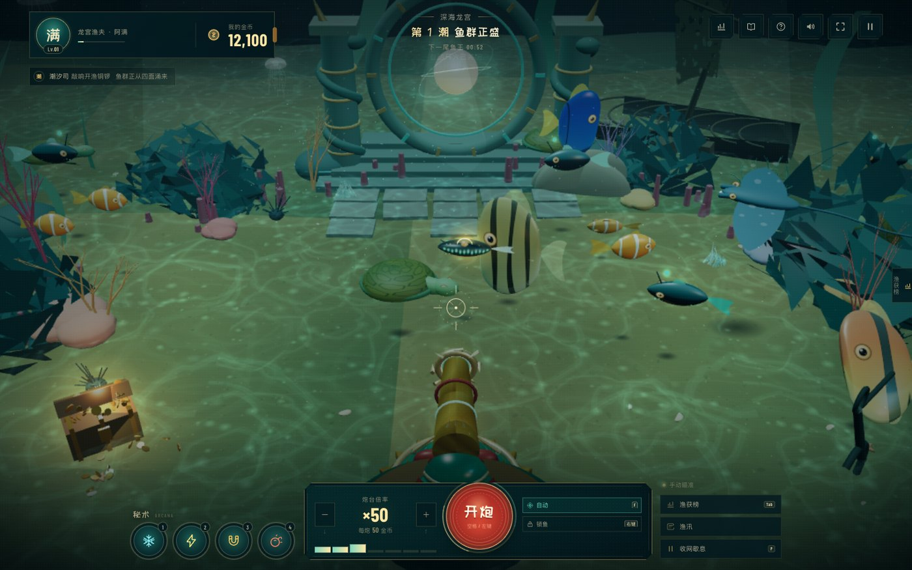

# 捕鱼达人 · 深海龙宫

一座可以用鼠标、键盘或手指亲手捕捞的实时 3D 龙宫渔场。经典捕鱼街机的炮台、押注、鱼群、连击、冰封、天雷、锁定与鱼王，被重新搭进了一片程序化生成的沉没宫殿。

**在线游玩：** https://liutao1992.github.io/fishing-joy-3d/

> 非官方 3D 同人重制。与《捕鱼达人》及其权利方无关联。游戏中的场景、鱼群、界面、音效与代码均为原创或运行时程序化生成，不含原作的图片、模型、音频或品牌素材。

## 玩法

- 用鼠标瞄准鱼群，按住左键或空格连发；准星下的鱼会显示身价与捕获难度。
- 滚轮 / ↑↓ / W S 升降炮台，每炮消耗与炮台倍率等额的金币。鱼的身价 = 鱼种倍率 × 炮台倍率。
- 右键锁定一条鱼，炮弹会追踪目标；也可以按 F 让炮台自动寻鱼开火。
- 四秒内连续收网可累积连击，最高获得 80% 额外渔获。
- 冰封、天雷、磁引、核爆四式秘术有独立冷却，不另收费。留到鱼群最密时使用。
- 黄金鲨王会定时巡海，它的血条显示在屏幕上方；击破后的赏金极其丰厚。
- 捕获金龙鱼可触发行运头奖；每日渔汛任务可在「渔获榜 → 今日渔汛」领取赏金。
- 金币耗尽时码头账房会自动送来救急金；连续五次之后，船长会请你收船返航。

## 键位

| 操作 | 键位 |
| --- | --- |
| 瞄准 | 鼠标移动 / `A` `D` / `←` `→` |
| 开炮 | 左键 / `空格`，按住连发 |
| 升降炮台、押注 | 滚轮 / `W` `S` / `↑` `↓` |
| 锁定准星下的鱼 | 鼠标右键 |
| 秘术 | `1` 冰封 · `2` 天雷 · `3` 磁引 · `4` 核爆 |
| 自动开火 | `F` |
| 切换镜头 | `C` |
| 渔获榜 / 今日渔汛 | `Tab` |
| 声音开关 | `M` |
| 全屏 | `V` |
| 操作说明 | `H` |
| 暂停 / 继续 | `Esc` 或 `P` |
| 开始游戏 | `Enter` |

触屏：拖动水面瞄准，按住即可连发，点按秘术按钮释放技能。横屏视野更开阔。

## 渔场

- **初涉浅湾**：5,000 金币准入，鱼群温顺，适合熟悉炮台。
- **深海龙宫**：12,000 金币准入，正选渔场，珍稀鱼种与金龙鱼常驻。
- **王座深渊**：50,000 金币准入，巨物与鱼王出没的深水断崖。

## 十二种海错

小丑鱼 ×2 · 红杉鱼 ×3 · 蓝刀鱼 ×5 · 灯笼鱼 ×8 · 海龟 ×12 · 神仙鱼 ×18 · 河豚 ×28 · 蝴蝶鱼 ×38 · 魔鬼鱼 ×68 · 鲨鱼 ×150 · 金龙鱼 ×300 · 黄金鲨王 ×600

身价以炮台倍率结算，例如 ×50 炮台捕获海龟可获得 50 × 12 = 600 金币。

## 实现

- Three.js / WebGL 实时渲染，全程序化几何与 Canvas 纹理；无外部模型、图片或音频。
- 沉没龙宫场景：珊瑚礁、海龟、河豚、海草、龙宫巨门、悬浮龙珠、沉船、宝箱、巨型砗磲与鲸油灯。
- 程序化鱼群 AI、鱼鳍动画、拖尾、水泡、神光、体积光、焦散和钢制炮台。
- Web Audio 合成的水下环境音、古筝式五声音阶、炮声、金币与秘术音效。
- 自适应内部分辨率、移动端低画质档位与触摸控制。
- 本地保存最高渔获、音效偏好与渔场选择。

## 第三方资源

- [Three.js](https://threejs.org/) — MIT，版权声明与许可见 `licenses/LICENSE-three.txt`。
- **ZCOOL KuaiLe** — SIL Open Font License 1.1，本作使用了为界面字符裁剪的 Web 字体子集；许可见 `licenses/OFL-ZCOOL-KuaiLe.txt`。
- **Barlow Condensed** — SIL Open Font License 1.1；许可见 `licenses/OFL-Barlow-Condensed.txt`。

字体许可见 `licenses/` 目录。游戏内的地图、鱼群插画、界面纹样与音效均为原创程序化创作，不包含官方素材。
